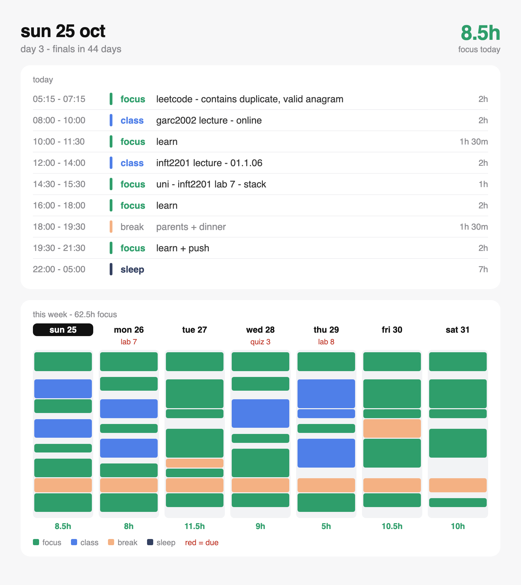

# Study Planner

A Telegram bot for university students. Every morning it sends one message: today's plan,
this week at a glance, what is due, and four buttons for your daily musts. Deadlines come from
your Brightspace (D2L) calendar and from messages you send the bot.



Under the image, the message lists today's classes with rooms, what is due in the next 7 days,
and the daily musts:

```
sun 25 oct - day 3

classes
- 08:00 garc2002 lecture - online
- 12:00 inft2201 lecture - 01.1.06

due
- tomorrow - inft2201 lab 7 - stack - 23:59
- wed - dsai3201 quiz 3 - 10:25
- thu - infs3104 lab 8 - queues - 23:59

musts
- leetcode 2h - contains duplicate, valid anagram
- learn 5.5h
- uni 1h - inft2201 lab 7 - stack
- push to github
- sleep 22:00

finals in 44 days
[leetcode] [learn] [uni] [push]
```

## What it does

- **Daily message** at 05:00 (or when your Mac wakes up): the image above plus the text.
- **Daily musts:** tap `leetcode`, `learn`, `uni` or `push` when done. Tap again to undo.
- **LeetCode:** works through the NeetCode 150 list, 2 new problems a day plus 1 review.
  A solved problem comes back as a review 3 and 10 days later. Unsolved ones move to the next day.
- **Deadline alerts** 3 days, 1 day and 3 hours before, with `done` and `snooze` buttons.
  Nothing is sent between 22:00 and 05:00.
- **Weekly summary** on Saturday at 20:00.
- **Exam mode** before finals: revision comes first, in exam order.

## Requirements

- macOS (it runs in the background with launchd)
- Python 3.11 or newer
- Google Chrome (to draw the image; without it the bot sends text only)
- A Brightspace (D2L) calendar feed link and a Telegram account

## Set up (about 10 minutes)

1. **Install**
   ```
   git clone <this repo> && cd study-planner
   python3 -m venv .venv
   .venv/bin/pip install -e '.[dev]'
   ```

2. **Create your bot.** In Telegram, open @BotFather, send `/newbot` and copy the token.

3. **Add your secrets.**
   ```
   cp .env.example .env
   chmod 600 .env
   ```
   Put the bot token and your D2L feed link in `.env`. To get the feed link, open D2L, go to
   Calendar, then Subscribe, then "All Calendars and Tasks", and copy the link.

4. **Find your chat id.** Send your new bot `/start` in Telegram, then run:
   ```
   .venv/bin/planner chat-id
   ```
   Put the number in `.env` as `TELEGRAM_CHAT_ID`. The bot answers only this chat.

5. **Add your timetable.**
   ```
   cp config/planner.example.toml config/planner.toml
   ```
   Edit `config/planner.toml`: your timezone, classes, exams and daily routine. The file
   explains each part.

6. **Check and preview.**
   ```
   .venv/bin/planner check
   .venv/bin/planner run --dry-run    # writes today's image and text to data/out
   ```

7. **Start it.**
   ```
   deploy/install_launchd.sh
   ```
   The bot now runs whenever you are logged in. To stop it: `deploy/install_launchd.sh --uninstall`.

Your Mac must be on and awake for messages to arrive on time. If it was asleep, the bot catches
up when it wakes.

## Talk to the bot

| Send | What happens |
|---|---|
| `garc essay due nov 2` | asks to save a new deadline (`save` / `cancel`) |
| `os midterm nov 5 10am` | the same, with a time; short names come from `[aliases]` in the config |
| `mizan 2h` | logs extra work; it counts as focus time |
| `/today` | sends today's message again |
| `/list` | deadlines in the next 14 days; remove your own items here |
| `/calendar` | a calendar file to add your deadlines and exams to your phone |
| `/help` | the list of commands |

## Commands

```
planner run            # do what is due now (launchd runs this every 30 minutes)
planner run --dry-run  # write today's image and text to data/out, send nothing
planner run --force    # send today's message now
planner preview DATE   # write the message for any day (YYYY-MM-DD) to data/out
planner bot            # run the Telegram bot (launchd keeps it running)
planner check          # check config, secrets, Chrome and the bot token
planner chat-id        # show your Telegram chat id
```

## How it works

| File | Job |
|---|---|
| `src/planner/ics.py` | reads the D2L feed; writes the calendar file |
| `src/planner/plan.py` | builds each day from the routine, classes, exams and deadlines |
| `src/planner/render.py` | the message text, the image (HTML to PNG with headless Chrome), the weekly text |
| `src/planner/jobs.py` | the schedule: feed every 6 hours, daily message, alerts, weekly summary |
| `src/planner/bot.py` | buttons and messages |
| `src/planner/store.py` | SQLite storage in `data/planner.db` |
| `src/planner/data/neetcode150.txt` | the LeetCode list, in order |

[SPEC.md](SPEC.md) lists every rule with an ID (for example `ALR-1`); the code and tests refer to
these IDs.

Your data stays on your Mac: `.env`, `config/planner.toml` and `data/` are git-ignored.

## Tests

```
.venv/bin/pytest
.venv/bin/ruff check src tests
```

The tests never touch the real feed, the real bot or your config.
